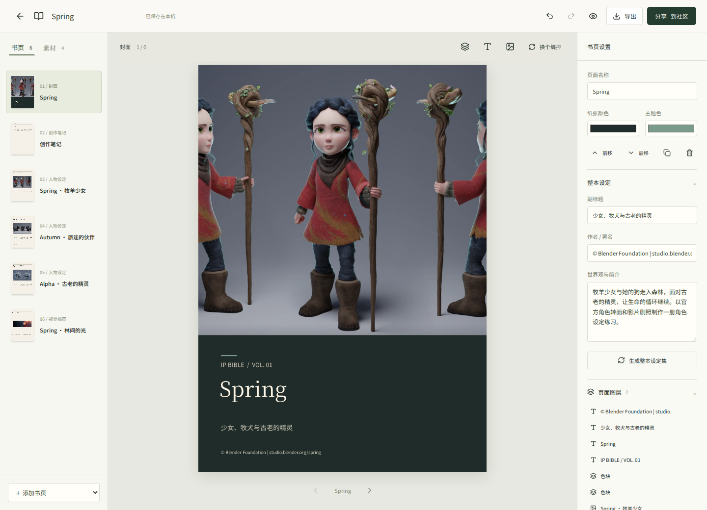

# IP Bible

**把你的角色与世界，编成一本可以继续生长的设定书。**

IP Bible 是一个开源、优先在本机处理素材的数字设定集编辑器。导入角色图、分层 PSD、地图和设定文字，生成书页，再自由调整图层、文案和页序。完成后，可以导出项目、PDF 或离线阅读版，也可以把阅读版分享到自建社区。

当前版本：`0.1.0`。已完成的检查与未验证范围见 [VALIDATION.md](VALIDATION.md)。



## 可以做什么

- **导入素材**：PSD、PNG、JPG、WebP，以及 TXT / Markdown。PSD 在浏览器拆层，保留分组路径、可见性、不透明度和原始位置；同一 PSD 文档的图层组合成一个设定页，并可独立取用。
- **生成设定书**：封面、人物设定、世界与地图、组织与势力、视觉档案、创作笔记。页面使用已有素材和作者填写的设定。
- **继续编排**：选择、移动、缩放、替换和排列图层，编辑文字，锁定元素，调整书页顺序，撤销与重做。
- **使用设计部件**：接入 JIZURA 的 195 个静态背景/装饰图形与 27 组配色，并附带本地中文字体。
- **探索布局**：结合 Evo-poster 的对齐与留白评价，对当前布局做有限进化；元素保持身份、尺寸和层序，锁定元素保持原位。
- **保存与导出**：IndexedDB 自动保存；`.ipbible` 可编辑项目包、A4 PDF、单文件 HTML 阅读版。
- **分享阅读版**：配套 Node 服务提供社区书架、阅读链接与发布者撤回。上传的是渲染后的书页，不是 PSD 或可编辑项目。
- **可选内容理解**：部署者配置兼容接口的多模态模型后，可由作者主动发送素材并审阅文字建议。

## 快速开始

需要 Node.js 22 或更高版本。

```bash
npm ci
npm run build
npm start
```

打开 [http://127.0.0.1:4315](http://127.0.0.1:4315)。这一方式同时提供编辑器、社区服务和可选模型接口。

开发前端可运行 `npm run dev`；Vite 开发服务本身不提供社区或模型 API。`npm test` 运行项目中现有的自动化检查；`npm run build` 包含 TypeScript 检查和前端构建。执行命令不等于完成浏览器、真实设备或印刷验收。

仅部署 `dist/` 到静态服务器也能使用本机编辑和导出；社区与模型功能需要配套服务。

## 做第一本设定集

1. 新建项目，或打开一份示例的可编辑副本。
2. 导入素材。查看 PSD 分层结果，补充人物、地点等内容类型及设定介绍。
3. 生成书页，调整章节顺序与页面内容。需要保护的图层可以锁定。
4. 定期导出 `.ipbible` 项目包作为备份；完成后导出阅读版或分享到社区。

`.ipbible` 是包含 `book.json` 的 ZIP 文件，携带页面结构和导入后的图层位图。它不包含原始 PSD，也不保留 Photoshop 的完整可编辑效果栈。请另外保存原始创作文件。

本机项目保存在当前浏览器、当前站点的 IndexedDB 中。它不会自动跨浏览器、设备或域名同步；清除站点数据会清除本机项目。社区阅读版不能恢复为完整可编辑项目。

## 服务端配置

服务通过进程环境变量配置，默认不读取 `.env` 文件。

| 环境变量 | 用途 | 默认值 |
| --- | --- | --- |
| `HOST` | 服务监听地址 | `127.0.0.1` |
| `PORT` | 服务端口 | `4315` |
| `IPBIBLE_DATA_DIR` | 社区阅读版持久化目录 | 项目下的 `data/` |
| `IPBIBLE_AI_API_KEY` | 可选模型服务密钥 | 未配置 |
| `IPBIBLE_AI_BASE_URL` | 兼容 Chat Completions 的 API 基础地址 | `https://api.openai.com/v1` |
| `IPBIBLE_AI_MODEL` | 支持图像输入与 JSON 输出的模型名称 | `gpt-4.1-mini` |

AI 密钥只在服务端使用。作者主动选择分析后，最多 12 份素材及相关设定文字会发送给配置的提供方；建议需经作者审阅后采用。未配置模型时，文件名/图层名辅助分类和几何排版仍可使用，**这不代表完成了模型理解，也不代表模型功能已经验证**。

社区目前是轻量阅读版服务，没有注册账号、付费、审核后台或协作编辑。发布者的撤回凭据保存在其浏览器中；清除浏览器数据后不会自动恢复。部署者应持久化并备份 `IPBIBLE_DATA_DIR`；公开运营所需的身份、管理与配额策略需按实际场景补充。

## PSD 与输出范围

- 标准 PSD，暂不支持 PSB；单文件上限 120 MB、画布上限 6400 万像素、最多 160 个可用栅格图层。
- 导入位图的最长边缩放至 2200 px；文档组合使用保留的原始尺寸与位置关系。
- 蒙版、剪贴、智能对象、复杂混合与图层效果不保证与 Photoshop 完全一致。导入提示指出需要核对的图层，可与合成预览比较。
- 设定文字以作者提供的信息为依据；人物关系、地图和势力范围需要有相应资料。排版算法不推断官方世界观。
- PDF 和 HTML 阅读版以渲染后的页面图片呈现；PDF 不是可编辑矢量排版或印厂色彩校样。继续编辑请使用 `.ipbible` 项目包。

## 示例 IP

附带 **Spring、Sintel、Big Buck Bunny** 三组 Blender 开放作品，供尝试人物与世界设定书的编排。它们使用正式公开的美术资料与电影画面；示例没有新增官方地图或势力设定。

图片的署名、许可、来源与修改记录见 [示例素材声明](public/examples/ATTRIBUTION.md) 和 [素材清单](public/examples/manifest.json)。代码的 MIT 许可不替代这些作品的 CC BY 许可。

## 开源来源与贡献

项目采用 [MIT License](LICENSE)。JIZURA、Evo-poster、CardLab、字体与示例作品的实际复用范围及独立许可见 [THIRD_PARTY_NOTICES.md](THIRD_PARTY_NOTICES.md)。

欢迎贡献 PSD 兼容性案例、设定书页型、文字排版、导出质量和可复用设计部件。报告问题时，请提供复现步骤、浏览器版本和可公开的最小样本；私人 IP 素材无需放进公开 issue。

---

## English

**Turn characters, worlds and source artwork into an editable IP artbook.**

IP Bible is an open-source, local-first editor for character and world bibles. Import images, layered PSD files and setting notes; assemble a book; then edit text, layers and page order. PSD layers are processed in the browser and grouped by source document for page composition.

The editor integrates 195 static JIZURA motifs, 27 palettes, local CJK fonts, and bounded layout evolution using Evo-poster metrics. Projects save to IndexedDB and export as editable `.ipbible` ZIP packages, raster A4 PDFs or standalone HTML readers. The optional Node server publishes read-only page snapshots to a community library; editable projects and original PSD files remain separate.

Run `npm ci`, `npm run build`, then `npm start` with Node.js 22+. Open `http://127.0.0.1:4315`. A compatible vision provider can be enabled through server environment variables; no configured provider means no model analysis, and configuration alone is not validation.

Back up editable projects separately from browser storage. Complex Photoshop effects may differ, and export output is not a print-production proof. Code is MIT; bundled artwork and fonts retain their own licenses. See the attribution documents above.
